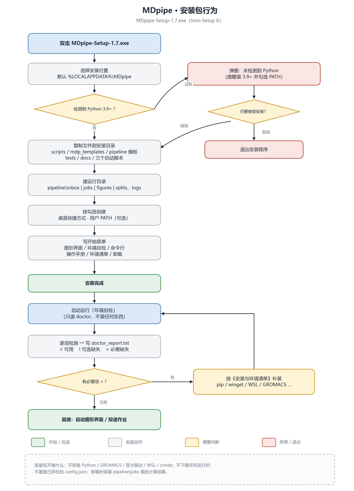

# 安装与环境清单：一台空电脑上要装什么

面向拿到安装包、机器上还没有任何分析环境的人。先给结论，再给逐项清单和最短路径。

---

## 一、结论

| 类别 | 有哪些 | 我们要做到什么程度 |
|---|---|---|
| **能自动装** | Python 包:numpy、scipy、matplotlib(必需),pandas、RDKit、PyMOL(可选) | 一条命令代装:`mdpipe doctor --install-pip`(需网络,会先列命令再确认) |
| **半自动** | Python 本身、WSL2 + Ubuntu、Miniforge、AmberTools、gmx_MMPBSA、LigPlot+、Ghostscript、OpenBabel、Tkinter | 给出确定能用的命令;需要管理员、重启或点安装向导的地方说明清楚,不假装一键 |
| **只能手动** | NVIDIA 驱动、Windows 版 CUDA GROMACS、显卡本身、CHARMM-GUI 账号 | 给下载地址和验收方法,程序不代装、不代注册 |
| **安装包不做的事** | 不打包、不静默安装上述任何运行时 | 只复制脚本和文档;装完弹「环境自检」指出还缺什么 |

一句话:**空机器上真正能“替你装”的只有 Python 包;其余要么要你点几下,要么必须你亲自装。**

## 安装包自己做了什么



（PDF 版:`pipeline/figures/installer_flow.pdf`;生成脚本 `scripts/plot_installer_flow.py`。）

看图时抓三条主线:

- **左侧主干**——选目录、复制文件、建 `pipeline\inbox|jobs|figures|splits`、写开始菜单,然后装完自动跑一次只读的「环境自检」。
- **右上分支**——检测不到 Python 3.9+ 时只弹窗提醒,让你选「继续安装」或「退出」;选继续也仍然只复制文件,不会替你装 Python。
- **右下分支**——自检写出 `doctor_report.txt`;若有「必需」项缺失,就照本清单补装,补完再跑一次自检,直到全部 √。

级别定义:

- **必需**——缺了流水线跑不起来。
- **默认路线**——默认的配体参数化(AmberTools)或 MM-PBSA 需要;如果你自备配体 `.itp/.gro` 或不做该功能,可以跳过。
- **建议**——影响速度或体验,不影响能不能跑。
- **可选**——缺了只是某项功能降级。

---

## 二、完整清单

| 组件 | 级别 | 安装方式 | 怎么装 / 从哪来 | 缺了会怎样 |
|---|---|---|---|---|
| Python 3.9+ | 必需 | 半自动 | `winget install --id Python.Python.3.12 -e`,或官网安装包(**勾选 Add python.exe to PATH**) | 所有脚本都跑不了 |
| numpy / scipy / matplotlib | 必需 | **自动** | `pip install numpy scipy matplotlib` | 分析和出图全部失败 |
| GROMACS(CUDA 版) | 必需 | 手动 | [manual.gromacs.org](https://manual.gromacs.org);Windows 没有官方 CUDA 二进制,需要自己获取 | 不能跑 MD,也不能做基于 gmx 的分析 |
| NVIDIA 驱动 | 建议 | 手动 | [nvidia.cn 驱动下载](https://www.nvidia.cn/Download/index.aspx),版本要满足 GROMACS 的 CUDA 要求 | 用 GPU 时必须;没有则只能 CPU |
| NVIDIA 显卡(建议 ≥6 GB 显存) | 建议 | — | 硬件 | 设 `use_gpu: false` 可纯 CPU 跑,慢约 30 倍 |
| WSL2 + Ubuntu | 默认路线 | 半自动 | 管理员 PowerShell:`wsl --install -d Ubuntu-24.04`;需重启,首次启动按提示建用户 | 不能自动做配体参数化和 MM-PBSA |
| Miniforge / conda | 默认路线 | 半自动 | WSL 内下载 Miniforge3 安装脚本并运行 | AmberTools / gmx_MMPBSA 没有宿主 |
| AmberTools | 默认路线 | 半自动 | `conda create -n amber -c conda-forge ambertools -y` | 不能从配体结构自动生成参数;自备 `.itp/.gro` 可跳过 |
| gmx_MMPBSA | 可选 | 半自动 | `conda create -n mmpbsa -c conda-forge ambertools gromacs=2019.6 -y && pip install gmx_MMPBSA` | `mmpbsa` 命令不可用 |
| pandas | 可选 | **自动** | `pip install pandas` | 少数表格输出不可用 |
| RDKit | 可选 | **自动** | `pip install rdkit` | 2D 相互作用图不出来 |
| PyMOL | 可选 | **自动** | `pip install pymol-open-source` | `viz` 只能出曲线,不能出结构图 |
| LigPlot+ | 可选 | 半自动 | 官网下载 zip,解压后把根目录填进 `config.json` 的 `ligplot_home`(或设 `LIGPLUS_HOME`) | 自动改用 RDKit 的 2D 图 |
| Ghostscript | 可选 | 半自动 | 官网 64 位安装包 | LigPlot+ 的 `.ps` 转不了 PNG/PDF |
| OpenBabel | 可选 | 半自动 | 官网安装包,或 `conda install -c conda-forge openbabel` | `.cif` 受体转换、配体加氢不可用 |
| Tkinter | 可选 | 半自动 | 装 Python 时勾选 tcl/tk | 图形界面打不开,命令行不受影响 |
| CHARMM-GUI 账号 | 可选 | 手动 | [charmm-gui.org](https://charmm-gui.org) 注册 | 网页提交功能不可用;密码由 DPAPI 加密保存 |

`mdpipe doctor --plan` 打印的就是这张表,和文档同源。

---

## 三、空空如也的电脑:按顺序做

下面的时间与体积都是量级估计,实际取决于网速和版本。

### 第 1 步:Python(约 5 分钟,150 MB)

```powershell
winget install --id Python.Python.3.12 -e
```

或从 [python.org](https://www.python.org/downloads/windows/) 装。**安装界面必须勾 Add python.exe to PATH**,否则后面所有命令都要写全路径。

验收:新开一个命令行,`python --version` 能输出版本号。

### 第 2 步:Python 包(约 2 分钟,200 MB)

```powershell
cd <项目目录>
python scripts\mdpipe.py doctor --install-pip
```

它会先列出 `pip install numpy scipy matplotlib` 再等你回车。要把 pandas / RDKit / PyMOL 一起装:

```powershell
python scripts\mdpipe.py doctor --install-pip --with-optional --yes
```

没有网络时,这步会失败并打印 pip 的原始错误;离线环境请从同版本轮子离线安装。

### 第 3 步:NVIDIA 驱动(约 15 分钟,需重启)

到 [nvidia.cn 驱动下载](https://www.nvidia.cn/Download/index.aspx) 按显卡型号和系统选驱动。**这一步不代装**——驱动是系统级组件,装错会让整台机器显示异常,必须由你确认型号。

验收:`nvidia-smi` 能列出显卡和驱动版本。

### 第 4 步:GROMACS(CUDA 版,约 10 分钟,200 MB)

从 [manual.gromacs.org](https://manual.gromacs.org) 获取 Windows 版。**目前 Windows 没有官方 CUDA 二进制**,所以要选带 GPU 支持的发行版(社区构建或自行编译)。

装好后路径不用手填:安装程序会运行 `mdpipe config --detect --write`,自动找到 `gmx.exe` 并写进 `pipeline\config.json`。也可以手动填,或随时重新探测:

```powershell
python scripts\mdpipe.py config --detect --write
```

```json
"gmx": "<GROMACS目录>/bin/gmx.exe"
```

验收:`gmx --version` 的输出里能看到 `GPU support: CUDA`。

### 第 5 步:确认“最小可跑”

```powershell
python scripts\mdpipe.py doctor
```

**必需项全绿**就可以投作业了。此时能做的事:从已有轨迹做分析、出图;如果有配体 `.itp/.gro`,也能从复合物 PDB 跑到 MD。

### 第 6 步(默认路线):WSL + Ubuntu(约 10 分钟,需重启)

```powershell
# 管理员 PowerShell
wsl --install -d Ubuntu-24.04
```

重启后首次启动 Ubuntu,按提示创建用户名和密码(记住它,后面 `wsl_home` 要填)。

验收:`wsl -l -q` 能看到 `Ubuntu-24.04`。

### 第 7 步(默认路线):Miniforge + AmberTools(约 20–40 分钟,3–5 GB)

在 WSL 里装 Miniforge(下载 Miniforge3 安装脚本后 `bash` 运行),然后:

```bash
conda create -n amber -c conda-forge ambertools -y
```

环境路径同样由安装程序自动探测并写入 `config.json` 的 `amber_home`,例如 `/home/<用户名>/miniconda3/envs/amber`;探测不到时运行 `python scripts\mdpipe.py config --detect --write`。

验收:`wsl -d Ubuntu-24.04 -e test -x /home/<用户名>/miniconda3/envs/amber/bin/antechamber && echo ok`。

### 第 8 步(可选):gmx_MMPBSA 环境(约 15 分钟,2–3 GB)

```bash
conda create -n mmpbsa -c conda-forge ambertools gromacs=2019.6 -y
conda activate mmpbsa && pip install gmx_MMPBSA
```

路径填进 `mmpbsa_env`。

### 第 9 步(可选):出图工具

RDKit / PyMOL 已在第 2 步;LigPlot+ 解压后填 `ligplot_home`;Ghostscript、OpenBabel 用安装包。装不装只影响图的种类,不影响 MD 结果。

---

## 四、最小可跑组合

| 你想做什么 | 最少需要 |
|---|---|
| 只分析已有轨迹 | Python + numpy/scipy/matplotlib + GROMACS |
| 从复合物 PDB 跑到 MD | 上面 + WSL/AmberTools(或自备配体 `.itp/.gro`) |
| 加 MM-PBSA | 上面 + gmx_MMPBSA 环境 |
| 加全套图 | 上面 + RDKit + PyMOL + LigPlot+ + Ghostscript |

注意:**GROMACS 在每一种组合里都需要**——分析步骤调用的 `gmx trjconv`、`gmx rms` 等没有替代品。

---

## 五、哪些东西我们不会替用户装,为什么

| 组件 | 原因 |
|---|---|
| NVIDIA 驱动 | 系统级、与显卡型号强绑定;装错可能导致显示异常。由用户确认型号后自己装 |
| Windows 版 CUDA GROMACS | 官方没有提供 CUDA 二进制,来源和编译选项会影响结果可比性;必须明确知道自己在用什么版本 |
| 商业 / 受限软件 | PyMOL 官方版、LigPlot+ 的许可需要用户自己接受;安装包只负责发现和支持 |
| CHARMM-GUI 账号 | 涉及个人账号和密码;程序只加密保存,不代注册 |
| 所有运行时二进制 | 许可证和体积都不适合捆绑;安装包只放脚本和文档 |

---

## 六、安装包做了什么、没做什么

做了:

- 复制 `scripts/`、`mdp_templates/`、`pipeline/` 模板、`tests/`、手册与本文档;
- 建好 `pipeline\inbox|jobs|figures|splits` 空目录;
- 开始菜单快捷方式、卸载项、可选的用户 PATH;
- 检测 Python 是否存在(缺失只提醒,不阻止安装);
- 装完自动打开「环境自检」;
- 可选:把 `skills\md-pipeline\SKILL.md` 复制到 `%USERPROFILE%\.clawsgo\skills\md-pipeline\`,
  让 AI 助手认识这套命令。别的 AI 工具用 `mdpipe skill --list` 查各自的目录,
  再用 `--target dsh|workbuddy|modao|codex|claude|...` 另装,或在 GUI「设置 → 安装 AI 技能…」
  里勾选;不绑定某一种 Harness。

没做:

- 不安装 Python、GROMACS、驱动、WSL、conda 环境;
- 不修改 `config.json` 里已存在的路径(升级时保留你的配置);
- 卸载时默认保留 `pipeline\jobs`(那是跑出来的数据)。

---

## 七、常见问题

**没有 NVIDIA 显卡能不能跑?**
能,但要在 `config.json` 里设 `"use_gpu": false`,改走纯 CPU。速度大约慢 30 倍,100 ns 的体系不适合这样跑。

**完全离线能装吗?**
能,但要预先准备好:Python 安装包、各 Python 包的离线轮子(`pip download`)、GROMACS 安装包、conda 环境的离线包。`doctor --install-pip` 需要网络,离线时请手动装轮子。

**我只想分析别人给的轨迹,还要 WSL 吗?**
不需要。WSL 只服务于配体参数化(AmberTools)和 MM-PBSA;纯分析只要有 Python 包和 GROMACS。

**配体参数能不能不走 AmberTools?**
可以。用 LigParGen、ATB 或 CGenFF 生成 `.itp` 和 `.gro`,投递时 `--ligand-itp X.itp --ligand-gro X.gro`,整条 WSL 路线就跳过了。

**装完怎么确认真的能跑?**
`mdpipe doctor` 必需项全绿,再投一个 1 ns 的测试作业(`--ns 1`),看 EM 最大力、NPT 密度、生产是否正常结束。
